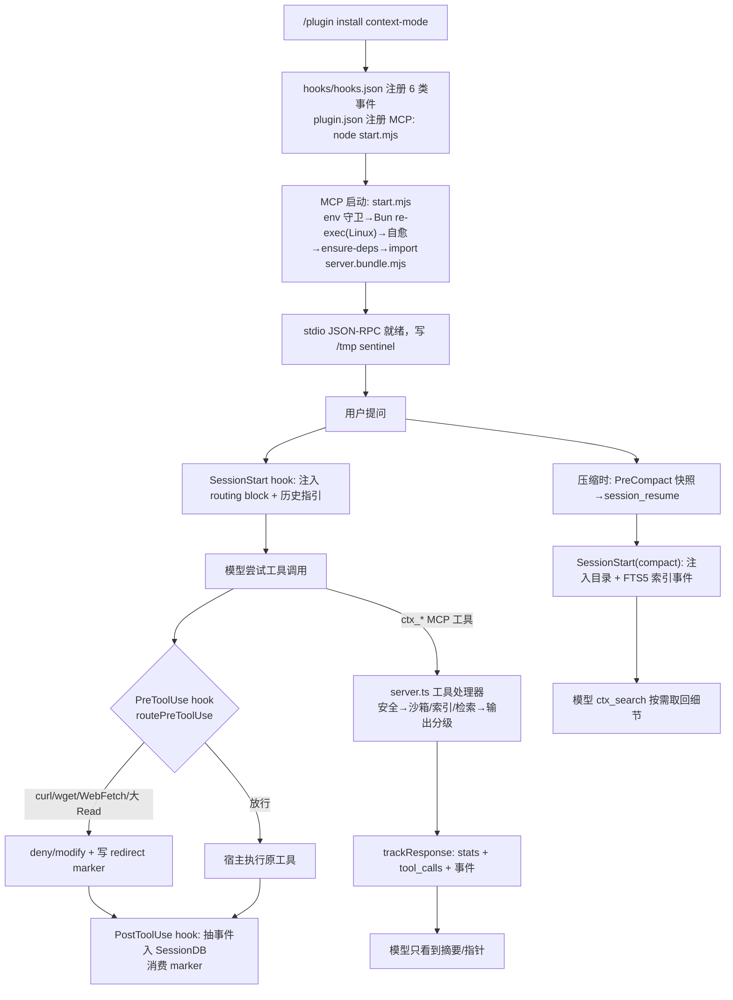

# context-mode — 架构与主流程

> 分析对象：`~/Projects/context-mode` @ v1.0.169。标注：**事实** / 推断 / 未知。

## 1. 分层与依赖方向

```
┌─────────────────────────────────────────────────────────────────────┐
│ 宿主客户端（19 个 PlatformId）: claude-code / codex / gemini-cli /   │
│ cursor / opencode / kilo / openclaw / pi / omp / kimi / kiro /      │
│ qwen-code / zed / vscode-copilot / jetbrains-copilot / copilot-cli /│
│ antigravity(-cli) / unknown           src/adapters/types.ts:474-493 │
└──────────────┬──────────────────────────────────┬───────────────────┘
               │ hooks（每次工具事件 spawn 一个进程）│ MCP stdio JSON-RPC
               ▼                                  ▼
┌──────────────────────────────┐   ┌──────────────────────────────────┐
│ hooks/*.mjs（独立进程，fail-  │   │ src/server.ts → server.bundle.mjs│
│ open，永远 exit 0）           │   │ 11 个 ctx_* MCP 工具             │
│ run-hook.mjs 包装             │   │ wrapToolHandler（计数/错误包装） │
└──────┬───────────────────────┘   └───────┬──────────────────────────┘
       │ 共享 hooks/core/*.mjs（routing、   │
       │ formatters、mcp-ready…）           │
       │                                   ▼
       │                     ┌─────────────────────────────────────┐
       │                     │ 领域层（src/）                      │
       │                     │  PolyglotExecutor  sandbox 执行     │
       │                     │  security.ts       策略求值         │
       │                     │  ContentStore      FTS5 知识库      │
       │                     │  SessionDB         会话事件         │
       │                     │  search/*          统一检索         │
       │                     └──────────┬──────────────────────────┘
       │                                │ db-base.ts（WAL/重试/自愈）
       ▼                                ▼
┌─────────────────────────────────────────────────────────────────────┐
│ SQLite（better-sqlite3，Linux 下优先 Bun 的 bun:sqlite）             │
│  content/<sha256(projectDir)>.db  知识库（chunks/chunks_trigram）    │
│  sessions/<hash>.db               会话事件（session_events 等 4 表） │
└─────────────────────────────────────────────────────────────────────┘
               ▲
┌──────────────┴──────────────────────────────────────────────────────┐
│ 分发/自愈层：start.mjs（MCP 启动入口）→ postinstall/heal/ensure-deps │
│ 打包：tsc → build/；esbuild → server.bundle.mjs / cli.bundle.mjs /  │
│       hooks/*.bundle.mjs（提交进 git，bundle.yml 自动重建）          │
└─────────────────────────────────────────────────────────────────────┘
```

**事实**：
- `PlatformId` 共 19 个取值（含 `unknown`）：src/adapters/types.ts:474-493。每种平台有 adapter（配置写入、hook 生成、路径契约）；`detect.ts:367-631` 按 clientInfo.name → `CONTEXT_MODE_PLATFORM` env → 平台 env 变量注册表 → config dir 存在性 → 兜底 claude-code 的顺序检测。
- Hook 进程与 MCP server 是两个独立进程族：hook 由宿主直接 spawn `node hooks/x.mjs`（或经 `context-mode hook <platform> <event>` 分发，cli.ts:77-185）；adapter 的 TS 代码不在 hook 调用路径上（hook 侧用 `hooks/session-helpers.mjs` 的 `*_OPTS` 镜像路径契约）。
- hooks 使用 bundle-first 加载：优先 `hooks/*.bundle.mjs`，回退 tsc 产物 `build/`（routing.mjs:367-413；session-loaders.mjs:31-52）。

## 2. 主流程 A：一次 `ctx_execute` 调用（沙箱执行 + 上下文保护）

**事实**（src/server.ts:1647-1952、executor.ts:282-571）：
1. 宿主 → MCP `tools/call` → `wrapToolHandler` 包装：`noteRequestStart()` 防止长任务被空闲回收（server.ts:294-320）。
2. **安全关卡**：shell 代码走 `checkDenyPolicy`（读 3 层 `.claude` settings 的 `permissions.deny`，先拆 `&& || ; |` 链与 `$()`/反引号子 shell，逐段匹配，任一段命中即整体拒绝，server.ts:1111-1132）；非 shell 代码走 `checkNonShellDenyPolicy`（正则提取 `execSync(...)`/`subprocess.run(...)` 等内嵌命令再匹配，security.ts:858-889）。
3. JS/TS 代码被**插桩**：包裹 async IIFE + 影子 require，统计 `fs.readFileSync` 字节（`__CM_FS__`）与 fetch/http 网络字节（`__CM_NET__`），进程退出时打到 stderr，服务端解析后累加到 `bytesSandboxed`（server.ts:1761-1819, 1829-1842）。
4. `PolyglotExecutor.execute`：
   - `mkdtempSync($REAL_TMPDIR/.ctx-mode-*)`（绕过被改写的 TMPDIR，executor.ts:99-111）
   - 按语言包装脚本（Go 补 package main、PHP 补 `<?php`、Elixir 预挂 `_build` 路径），写临时文件（shell 脚本权限 0700）
   - `buildCommand`（runtime.ts）按检测到的 runtime 生成 argv；所有语言 cwd=项目根
   - `#spawn`：env 白名单化（约 90 个危险变量 denylist：`BASH_ENV`/`NODE_OPTIONS`/`LD_PRELOAD`/`DYLD_INSERT_LIBRARIES`/`COMPlus_*`…，executor.ts:573-745）；Unix 上 detached 建进程组、超时杀整组；stdout+stderr 合计超过 100MB 立即杀（server.ts:510-537）
   - `background:true` 时超时后不杀，转为 unref + 排空管道（executor.ts:475-504）
5. **输出膨胀三档策略**（这是 "省 context" 的核心）：
   - 输出 > 5KB 且调用方给了 `intent` → `intentSearch`：把全文 `indexPlainText` 进持久知识库，`searchWithFallback(intent)` 检索，**只返回**章节标题 + 首行预览 + 可搜索词表（server.ts:1982-2036）
   - 输出 > 100KB → `indexStdout`：索引后只返回"索引了 N 节，用 ctx_search 查"的指针（server.ts:1958-1973）
   - 否则原样返回，但前置 `buildExecuteEcho`（回显执行的代码/路径，供用户审计，server.ts:1523-1527）
6. `trackResponse` 收尾：累计每工具 calls/bytes → `persistStats()` 写状态栏 sidecar JSON（500ms 节流；schemaVersion 2；含 tokens_saved、dollars_saved）→ `setImmediate` 写 SessionDB `tool_calls` 计数 + 发 `bytes_avoided`/`bytes_returned` 事件（server.ts:885-949）。

**推断**：`4 字节/token`、`256 tokens/事件` 是内部的换算常数（server.ts:986-987），用于把"省下的字节"折算成钱。

## 3. 主流程 B：PreToolUse 拦截（hooks 侧"路由"）

**事实**（hooks/pretooluse.mjs:23-227；hooks/core/routing.mjs:670-1017）：
1. 宿主在每次工具调用前 spawn `hooks/pretooluse.mjs`（6 类事件之一，hooks/hooks.json）。
2. `runHook` 包装所有 hook：加载失败写 `<configDir>/context-mode/hook-errors.log`，**永远 exit 0**（run-hook.mjs:15-95）——避免宿主把 hook 报错当成拒绝。
3. 路由判定（按工具）：
   - **Bash**：先查用户 `permissions.deny`（可 deny/ask）；`curl/wget` 段（无 `-o/-O/-s`）→ `modify` 把命令重写成 `echo "重定向引导"`；内联 HTTP（`fetch('http`、`requests.get(` 等）→ 同样改写；`gradle/maven/sbt` → 改写；已有界命令（`pwd`、`git status`、`--version`）放过。
   - **Read**：文件 > 50,000 字节 → 附带 `redirectMeta{type:"read-redirected",bytesAvoided:size}`。
   - **Grep**：一次性引导提示。
   - **WebFetch**：硬 `deny`，引导改用 `ctx_fetch_and_index`/`ctx_execute`。
   - **Agent**：把 routing block 追加进 subagent prompt（`createRoutingBlock(..., {includeCommands:false})`）。
   - **MCP ctx_* 工具**：安全策略检查；Claude Code 下把 cwd 钉到项目根。
   - **外部 MCP 工具**：每 N 次调用（默认 10）提醒一次。
4. 所有重定向在两种情况下被抑制：MCP 哨兵未就绪（`/tmp/context-mode-mcp-ready-*` 扫描，core/mcp-ready.mjs:73-108）、subagent 上下文（`mcpToolsAvailable:false`）。
5. **redirect marker 机制**：PreToolUse 无法安全打开 SQLite，于是把事件写成 tmp 标记文件（`context-mode-rejected-<session>.txt`、`context-mode-redirect-<session>.txt`（含 `bytesAvoided`）、latency 标记）；PostToolUse 读后即删，转成 `rejected-approach`/`redirect`/`latency` 事件入库（pretooluse.mjs:175-221；posttooluse.mjs:62-179）。
6. **SessionStart** 每次都会注入 routing block（XML `<context_window_protection>`，工具选择优先级、文件输出政策、ctx 命令表；routing-block.mjs:16-80）到 `additionalContext`；OpenClaw 走 `before_prompt_build` 的 `prependSystemContext/appendSystemContext`（openclaw/plugin.ts:789-837）。

## 4. 主流程 C：压缩/恢复（会话连续性）

**事实**（precompact.mjs:33-99；sessionstart.mjs；session/snapshot.ts；server.ts:508-521）：
1. **PreCompact**：读本会话全部 `session_events` → `buildResumeSnapshot` 生成 XML"目录"（session_goal、files top10、errors、decisions、rules、git、task_state、environment、subagents、skills、roles、intent、recent_user_messages 各一节；**每节内嵌一条可直接运行的 ctx_search 调用**）→ `session_resume` 表 upsert（consumed=0）+ `compact_count+1`。
2. **SessionStart(compact)**：写 `<hash>-events.md`（人读版事件清单）→ 注入 session directive（上次请求、未完成任务、决策、文件、错误、git、plan 状态、"不要问用户重复信息"）+ auto-injection 行为状态。
3. 事件清单被 MCP server 的 `maybeIndexSessionEvents` 索引进 FTS5（source=`session-events`）后**删除文件**；模型需要细节时用 `ctx_search(source:"session-events")` 按需取。
4. **SessionStart(resume)**：若新会话 id 没有 live 事件，`claimLatestUnconsumedResume` 用 `UPDATE … RETURNING` 原子领取上一条未消费快照注入（防止重复领取/自我注入，db.ts:1059-1078, 1601）。
5. 服务端也在持续写事件：沙箱执行、索引写入、缓存命中通过 `event-emit.ts` 以 setImmediate 落库；`ctx_search`/`ctx_fetch_and_index` 的字节数经 tmp 标记由下一次 PostToolUse 转发（server.ts:917-946；retrieval-marker.ts）。
6. 不 `--continue` 时旧会话数据在下次 SessionStart(startup) 时清理（README:41；sessionstart startup 分支）。

## 5. 检索主流程：`ctx_search` 怎么找到东西

**事实**（store.ts:1122-1405；search/unified.ts；server.ts:2553-2810）：
- 默认 `sort:"relevance"`（只查 ContentStore）；`sort:"timeline"` 合并 ContentStore + 历史 SessionDB 事件 + auto-memory 并按时间排序（unified.ts:133-173）。
- 每次查询并行跑两个匹配器：porter 词干表（`chunks`，`bm25(chunks,5,1)` 标题权重 5×）+ trigram 子串表（`chunks_trigram`），用 **RRF（K=60）** 融合（store.ts:1244-1284）。
- 多词查询再做**邻近度重排**（title 命中加成 + 最小跨度 + 相邻对数量，仅作用于 top-limit 行，store.ts:1288-1336）。
- 查不到 → 拼写纠正（vocabulary 表 + Levenshtein，容差按词长 1/2/3，256 条 LRU 缓存）后用纠正词重跑 RRF（store.ts:1195-1240）。
- 结果片段用 `extractSnippet` 取窗口（不是粗暴截断）；总输出 40KB 上限；防刷 `FloodGuard` 按 agent 会话键控：60s 窗口内第 4 次起每查询只给 1 条，第 8 次起直接拒绝并命令改用 `ctx_batch_execute`（server.ts:2457-2470, 2655-2670）。
- 文件型来源带 content_hash，源文件变了会在搜索时自动标记 stale 并刷新（store.ts:1415-1459）。

## 6. 数据布局（运行时）

**事实**：
| 路径 | 内容 |
|---|---|
| `<configDir>/context-mode/content/<sha256(projectDir)[:16]>.db` | 知识库（per-project），如 `~/.claude/context-mode/content/` |
| `<configDir>/context-mode/sessions/<hash>.db` | 会话事件库 |
| `<configDir>/context-mode/sessions/stats-<sessionId>.json` | 状态栏 sidecar（500ms 刷新，60s 心跳） |
| `~/.context-mode/platform.json` | 可选遥测转发配置（platform-bridge.mjs） |
| `/tmp/context-mode-mcp-ready-<pid>` | MCP 就绪哨兵（hook 据此决定是否重定向；30s 刷新 mtime） |
| `<configDir>/context-mode/hook-errors.log` | hook 失败日志 |
| `$CONTEXT_MODE_DIR`（可选） | 覆盖存储根：`<root>/content`、`<root>/sessions` |

## 7. 关键设计决策（有 ADR 佐证）

**事实**：
- **ADR-0001**：SessionDB/ContentStore 采用多写者契约——靠 WAL + `busy_timeout=30000` + `withRetry`（3 次，100/500/2000ms），不再用 `locking_mode=EXCLUSIVE`/锁文件（v1.0.128→v1.0.130 移除）。残余风险：WAL 无界增长，靠退出钩子 checkpoint + 每 50 次插入 FTS optimize 缓解。
- **ADR-0002**：工具描述风格（WHEN / WHEN NOT / RETURNS / EXAMPLE，server.ts:1660-1741 全是这个格式）。
- **ADR-0003**：deny 理由文案（为什么某命令被路由改写）。
- **ADR-0004**：统计口径 = 严格压缩公式（`reduction = 1 - returned/processed`，server.ts:1032-1040）。
- **fail-open 原则**：hook 永远 exit 0；安全检测抛异常时放行（server 侧注释明确"hooks 才是主执法层"，server.ts:1127-1131）；MCP 未就绪时不重定向。
- **提示词分层**：详见 `notes/prompt-engineering.md`——P1 工具描述（ADR-0002 的 WHEN/WHEN NOT/RETURNS/EXAMPLE + 8 条禁用词 + contract test）/ P2 routing block（`routing-block.mjs:16-80` 的 0-3 选型层级 + 子代理 bootstrap）/ P3 重定向≠拒绝（ADR-0003 CASE A/B，`routing.mjs:767-889`）/ P4 快照+指令+auto-injection（`snapshot.ts:475-577`、`session-directive.mjs:275-500`、500 tokens 预算）/ P5 运行时指针与节流文案（`server.ts:1958-2036,2654-2782`）/ P6 Skills 与 `CLAUDE.md` 静态指令（含与 ADR 字面冲突的 MANDATORY/BLOCKED，推断为刻意分层，未证实）。

## 8. 模块地图（代码量与职责）

**事实**（wc -l 实测 + 源码阅读）：
| 模块 | 行数 | 职责 |
|---|---|---|
| src/server.ts | 4991 | MCP server 与 11 个工具（唯一巨型文件） |
| src/session/* | ~10,000 | 会话事件抽取/存储/快照/分析/清理（extract 2960、analytics 3085、db 1726） |
| src/cli.ts | 2040 | CLI（index/search/doctor/upgrade/hook 分发/statusline/insight） |
| src/store.ts | 2071 | FTS5 知识库：分块、索引、检索管线 |
| src/adapters/* | ~9,600 | 19 平台适配（含 pi/mcp-bridge 1060、codex 1204、openclaw/plugin 1039） |
| hooks/*.mjs | ~4,900 | 6 类事件脚本 + 共享 core/ |
| src/executor.ts | 785 | 多语言沙箱执行 |
| src/security.ts | 889 | 策略求值（链式拆分、子 shell、glob→regex、边界包含） |
| src/runtime.ts | 765 | 语言 runtime 探测与命令构建 |
| scripts/* | ~2,300 | 安装自愈/postinstall/打包断言/版本同步 |
| tests/* | ~300 文件 | vitest（单元+集成+基准脚本） |

## 9. 图：装到用起来的完整链路（Claude Code 为例）


